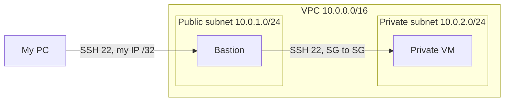
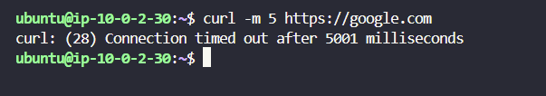
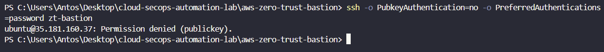

# 🛡️ AWS Zero-Trust Cloud & SecOps Automation Lab


> Work in progress.

This Terrafrom IaC deployment lab has been made to learn.
The goal was to automaticly deploy a Zero-Trust inspired infrastructure with Terraform.



## What is declared

18 resources has been declared in this repository and deployed temporary on AWS Cloud :
- 1 VPC
- 1 Internet Gateway
- 2 Subnets (public and private)
- 2 route tables
    - with their 2 associations
- 1 default security group, emptied on purpose
- 2 security groups
    - with their 4 rules
- 1 SSH key pair
- 2 EC2 instances (the bastion and a private VM)

## Choices worth explaining
 
The security groups start empty and only allow what I list. The bastion accepts
SSH from my IP and nothing else. A validation rule in `variables.tf` refuses
`0.0.0.0/0`, so I cannot open it by mistake.

The private VM accepts SSH from the bastion's security group instead of an IP
range. If the bastion's address changes, the rule still holds, and nothing else
in the public subnet can reach the VM.

The private key stays on my PC. I reach the VM with SSH `ProxyJump`, so the
bastion only relays the connection. Both instances use IMDSv2 and encrypted
volumes, with password and root login disabled.

## Run it
 
```bash
cd aws-zero-trust-bastion
cp terraform.tfvars.example terraform.tfvars
terraform init
terraform plan
terraform apply
```

Run `terraform destroy` when you are done. A few cents per hour while it is up.

## What I checked
 

 
`curl` from the private VM times out: it has no way out.
 

 
Password login on the bastion is refused with `Permission denied (publickey)`.
 
## Limits
 
Port 22 is still open to one IP. SSM Session Manager would remove it.
 
The bastion can reach any address on port 443 for updates, which a scanner like
tfsec or Trivy will flag.